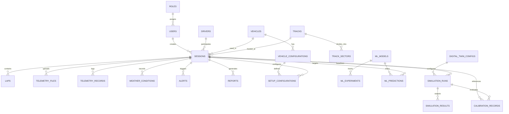

# Database Design & Schema Specification
## Kurukshetra Kart — IC Go-Kart Telemetry, Predictive Analytics & Digital Twin Platform
**Organisation:** Kurukshetra Racing, SKCET  
**Competition:** EKVC Season 4 — Innovation Round  
**Document Version:** 1.0.0  
**Status:** Approved for Implementation  
**Date:** November 2026  

---

## 1. Database Architecture Overview

Kurukshetra Kart utilizes a dual-tier database architecture to support local offline pit-wall operation, edge testing, and production telemetry archival:

- **Development & Trackside Edge Deployment:** **SQLite** with Write-Ahead Logging (`WAL` mode) for zero-configuration, single-file deployment on laptops and pit-side edge gateways.
- **Production & Cloud Telemetry Archival:** **PostgreSQL 16** with optional **TimescaleDB** extension for high-throughput time-series chunk compression and hypertable partitioning.

The database schema is mapped using **SQLAlchemy 2.0** models and managed through **Alembic** migration scripts to guarantee schema parity across both database backends.

---

## 2. Entity-Relationship Diagram

---

## 3. Relational Entity Schemas

### 3.1 Identity & Access Control

#### 1. `roles`
Defines permission levels for system users.
- `id` (VARCHAR(36), PK): UUID.
- `name` (VARCHAR(50), UNIQUE, NOT NULL): e.g. `ADMIN`, `TELEMETRY_ENGINEER`, `DATA_ENGINEER`, `ML_ENGINEER`, `DYNAMICS_ENGINEER`, `DRIVER`, `TEAM_MANAGER`.
- `description` (TEXT): Scope of authorization.
- `created_at` (TIMESTAMP, NOT NULL): UTC creation timestamp.

#### 2. `users`
System accounts for engineers, managers, and drivers.
- `id` (VARCHAR(36), PK): UUID.
- `username` (VARCHAR(50), UNIQUE, NOT NULL).
- `email` (VARCHAR(120), UNIQUE, NOT NULL).
- `hashed_password` (VARCHAR(255), NOT NULL).
- `role_id` (VARCHAR(36), FK -> `roles.id`, NOT NULL).
- `is_active` (BOOLEAN, DEFAULT TRUE).
- `created_at` (TIMESTAMP, NOT NULL).
- `updated_at` (TIMESTAMP, NOT NULL).

---

### 3.2 Vehicle, Track & Driver Assets

#### 3. `drivers`
Kart driver profiles and baseline biometrics.
- `id` (VARCHAR(36), PK): UUID.
- `name` (VARCHAR(100), NOT NULL).
- `racing_number` (INTEGER, NOT NULL).
- `weight_kg` (FLOAT, NOT NULL): Driver mass with racing gear.
- `experience_level` (VARCHAR(50), DEFAULT 'COLLEGIATE').
- `created_at` (TIMESTAMP, NOT NULL).

#### 4. `vehicles`
Physical go-kart chassis registry.
- `id` (VARCHAR(36), PK): UUID.
- `name` (VARCHAR(100), NOT NULL): e.g. `Kurukshetra IC-04`.
- `chassis_code` (VARCHAR(50), UNIQUE, NOT NULL).
- `engine_type` (VARCHAR(100), NOT NULL): e.g. `125cc 4-Stroke IC Engine`.
- `dry_mass_kg` (FLOAT, NOT NULL): e.g. `115.0`.
- `wheelbase_m` (FLOAT, NOT NULL): e.g. `1.04`.
- `track_width_m` (FLOAT, NOT NULL): e.g. `1.12`.
- `created_at` (TIMESTAMP, NOT NULL).

#### 5. `vehicle_configurations`
Detailed physical and aerodynamic parameters.
- `id` (VARCHAR(36), PK): UUID.
- `vehicle_id` (VARCHAR(36), FK -> `vehicles.id`, NOT NULL).
- `name` (VARCHAR(100), NOT NULL): e.g. `V1 Base Sprint Trim`.
- `drag_coefficient_cd` (FLOAT, NOT NULL): e.g. `0.65`.
- `frontal_area_m2` (FLOAT, NOT NULL): e.g. `0.42`.
- `rolling_resistance_crr` (FLOAT, NOT NULL): e.g. `0.018`.
- `engine_power_kw` (FLOAT, NOT NULL): Peak engine power (e.g. `7.5` kW / ~10 HP).
- `max_rpm` (INTEGER, NOT NULL): Rev limiter (e.g. `9500`).
- `gear_ratio` (FLOAT, NOT NULL): Sprocket ratio (e.g. `4.2`).
- `created_at` (TIMESTAMP, NOT NULL).

#### 6. `tracks`
Racing circuit layout metadata.
- `id` (VARCHAR(36), PK): UUID.
- `name` (VARCHAR(100), NOT NULL): e.g. `SKCET Innovation Track`.
- `location` (VARCHAR(150)).
- `length_meters` (FLOAT, NOT NULL): e.g. `850.0`.
- `num_turns` (INTEGER, NOT NULL): e.g. `9`.
- `surface_type` (VARCHAR(50), DEFAULT 'ASPHALT').
- `centerline_geometry` (TEXT): GeoJSON / WKT coordinate string.
- `created_at` (TIMESTAMP, NOT NULL).

#### 7. `track_sectors`
Sector split markers and corner geometry.
- `id` (VARCHAR(36), PK): UUID.
- `track_id` (VARCHAR(36), FK -> `tracks.id`, NOT NULL).
- `sector_number` (INTEGER, NOT NULL): 1, 2, or 3.
- `start_distance_m` (FLOAT, NOT NULL).
- `end_distance_m` (FLOAT, NOT NULL).
- `is_corner` (BOOLEAN, DEFAULT FALSE).
- `corner_radius_m` (FLOAT, NULLABLE): Radius $R$ for turn limit calculations.
- `corner_direction` (VARCHAR(10), NULLABLE): `LEFT` or `RIGHT`.

---

### 3.3 Session & Telemetry Storage

#### 8. `sessions`
Track outing record linking kart, driver, track, and status.
- `id` (VARCHAR(36), PK): UUID (e.g. `sess_20261108_01`).
- `name` (VARCHAR(150), NOT NULL).
- `date` (TIMESTAMP, NOT NULL).
- `track_id` (VARCHAR(36), FK -> `tracks.id`, NOT NULL).
- `driver_id` (VARCHAR(36), FK -> `drivers.id`, NOT NULL).
- `vehicle_id` (VARCHAR(36), FK -> `vehicles.id`, NOT NULL).
- `vehicle_config_id` (VARCHAR(36), FK -> `vehicle_configurations.id`, NOT NULL).
- `status` (VARCHAR(30), DEFAULT 'ACTIVE'): `ACTIVE`, `COMPLETED`, `ABORTED`.
- `total_laps` (INTEGER, DEFAULT 0).
- `best_lap_time_s` (FLOAT, NULLABLE).
- `avg_lap_time_s` (FLOAT, NULLABLE).
- `created_by` (VARCHAR(36), FK -> `users.id`, NOT NULL).
- `created_at` (TIMESTAMP, NOT NULL).

#### 9. `laps`
Lap statistics, segment splits, and validation metrics.
- `id` (VARCHAR(36), PK): UUID.
- `session_id` (VARCHAR(36), FK -> `sessions.id`, NOT NULL).
- `lap_number` (INTEGER, NOT NULL).
- `lap_time_s` (FLOAT, NOT NULL).
- `sector_1_time_s` (FLOAT, NULLABLE).
- `sector_2_time_s` (FLOAT, NULLABLE).
- `sector_3_time_s` (FLOAT, NULLABLE).
- `max_speed_kmh` (FLOAT, NOT NULL).
- `min_speed_kmh` (FLOAT, NOT NULL).
- `avg_rpm` (FLOAT, NOT NULL).
- `max_lateral_g` (FLOAT, NOT NULL).
- `is_valid` (BOOLEAN, DEFAULT TRUE): Flagged false on in-lap, out-lap, or spin.

#### 10. `telemetry_files`
Metadata for raw SD card and wireless capture dumps.
- `id` (VARCHAR(36), PK): UUID.
- `session_id` (VARCHAR(36), FK -> `sessions.id`, NOT NULL).
- `file_name` (VARCHAR(255), NOT NULL).
- `file_path` (VARCHAR(500), NOT NULL): Storage location in `data/raw/`.
- `file_format` (VARCHAR(20), NOT NULL): `CSV` or `BINARY_16B`.
- `file_size_bytes` (BIGINT, NOT NULL).
- `record_count` (INTEGER, NOT NULL).
- `checksum_sha256` (VARCHAR(64), NOT NULL).
- `is_processed` (BOOLEAN, DEFAULT FALSE).
- `uploaded_at` (TIMESTAMP, NOT NULL).

#### 11. `telemetry_records`
Canonical time-series sensor observations.
- `id` (BIGINT, PK, AUTOINCREMENT).
- `session_id` (VARCHAR(36), FK -> `sessions.id`, NOT NULL, INDEX).
- `lap_id` (VARCHAR(36), FK -> `laps.id`, NULLABLE, INDEX).
- `timestamp_us` (BIGINT, NOT NULL, INDEX): Microseconds from ESP32 master clock.
- `speed_kmh` (FLOAT, NOT NULL).
- `engine_rpm` (INTEGER, NOT NULL).
- `engine_temp_c` (FLOAT, NOT NULL).
- `steering_angle_deg` (FLOAT, NOT NULL).
- `throttle_percent` (FLOAT, NOT NULL).
- `accel_x_g` (FLOAT, NOT NULL): Longitudinal acceleration.
- `accel_y_g` (FLOAT, NOT NULL): Lateral acceleration.
- `accel_z_g` (FLOAT, NULLABLE): Vertical acceleration.
- `gyro_z_degps` (FLOAT, NULLABLE): Yaw rate.
- `obstacle_distance_cm` (FLOAT, NULLABLE): Raw ultrasonic / ToF reading.
- `closing_speed_mps` (FLOAT, NULLABLE): Derived closing velocity.
- `ttc_seconds` (FLOAT, NULLABLE): Time-to-contact ($d / v_{close}$).
- `warning_level` (VARCHAR(20), DEFAULT 'SAFE'): `SAFE`, `CAUTION`, `DANGER`.
- `sensor_status` (TEXT): JSON status bitfield.

#### 12. `weather_conditions`
Atmospheric parameters affecting engine power and tire grip.
- `id` (VARCHAR(36), PK): UUID.
- `session_id` (VARCHAR(36), FK -> `sessions.id`, NOT NULL).
- `ambient_temp_c` (FLOAT, NOT NULL): e.g. `31.5`.
- `track_temp_c` (FLOAT, NULLABLE): e.g. `44.0`.
- `relative_humidity_pct` (FLOAT, NOT NULL): e.g. `62.0`.
- `barometric_pressure_hpa` (FLOAT, NOT NULL): e.g. `1011.2`.
- `air_density_kgm3` (FLOAT, NOT NULL): Calculated $\rho$ for drag & carburetion.
- `track_condition` (VARCHAR(30), DEFAULT 'DRY'): `DRY`, `DAMP`, `WET`.

#### 13. `setup_configurations`
Chassis setup parameters recorded for each track run.
- `id` (VARCHAR(36), PK): UUID.
- `session_id` (VARCHAR(36), FK -> `sessions.id`, NOT NULL).
- `tire_pressure_front_psi` (FLOAT, NOT NULL).
- `tire_pressure_rear_psi` (FLOAT, NOT NULL).
- `front_track_width_mm` (FLOAT, NOT NULL).
- `rear_track_width_mm` (FLOAT, NOT NULL).
- `gear_sprocket_teeth` (INTEGER, NOT NULL).
- `notes` (TEXT).

---

### 3.4 Machine Learning Tracking & Inference

#### 14. `ml_models`
Trained model artifact registry.
- `id` (VARCHAR(36), PK): UUID.
- `model_name` (VARCHAR(100), NOT NULL): `engine_anomaly_detector`, `lap_time_predictor`, `driver_behaviour_classifier`, `grip_estimator`.
- `version` (VARCHAR(50), NOT NULL): Semantic version (e.g. `v1.2.0`).
- `algorithm` (VARCHAR(100), NOT NULL): e.g. `IsolationForest`, `XGBoostRegressor`.
- `hyperparameters` (TEXT): JSON dictionary.
- `artifact_path` (VARCHAR(500), NOT NULL): Serialized `.joblib` model file path.
- `is_active` (BOOLEAN, DEFAULT FALSE).
- `trained_at` (TIMESTAMP, NOT NULL).

#### 15. `ml_experiments`
Training run metrics and evaluation tracking.
- `id` (VARCHAR(36), PK): UUID.
- `model_id` (VARCHAR(36), FK -> `ml_models.id`, NOT NULL).
- `dataset_hash` (VARCHAR(64), NOT NULL).
- `train_records_count` (INTEGER, NOT NULL).
- `test_records_count` (INTEGER, NOT NULL).
- `mae` (FLOAT, NULLABLE): Mean Absolute Error.
- `rmse` (FLOAT, NULLABLE): Root Mean Square Error.
- `r2_score` (FLOAT, NULLABLE): Coefficient of determination.
- `f1_score` (FLOAT, NULLABLE): Classification F1 metric.
- `evaluation_summary` (TEXT): JSON metrics blob (confusion matrix, ROC AUC).
- `executed_at` (TIMESTAMP, NOT NULL).

#### 16. `ml_predictions`
Batch and live inference audit trail.
- `id` (VARCHAR(36), PK): UUID.
- `model_id` (VARCHAR(36), FK -> `ml_models.id`, NOT NULL).
- `session_id` (VARCHAR(36), FK -> `sessions.id`, NOT NULL).
- `lap_id` (VARCHAR(36), FK -> `laps.id`, NULLABLE).
- `input_features` (TEXT, NOT NULL): JSON feature vector.
- `prediction_value` (FLOAT, NOT NULL): Scalar prediction or score.
- `confidence_score` (FLOAT, NULLABLE).
- `anomaly_flag` (BOOLEAN, DEFAULT FALSE).
- `created_at` (TIMESTAMP, NOT NULL).

---

### 3.5 Digital Twin & What-If Simulation

#### 17. `digital_twin_configs`
Simulation model parameter sets.
- `id` (VARCHAR(36), PK): UUID.
- `name` (VARCHAR(100), NOT NULL).
- `kart_mass_kg` (FLOAT, NOT NULL).
- `effective_grip_mu` (FLOAT, NOT NULL).
- `aerodynamic_cd` (FLOAT, NOT NULL).
- `frontal_area_m2` (FLOAT, NOT NULL).
- `rolling_resistance` (FLOAT, NOT NULL).
- `peak_power_kw` (FLOAT, NOT NULL).
- `created_at` (TIMESTAMP, NOT NULL).

#### 18. `simulation_runs`
Execution history of the physics digital twin.
- `id` (VARCHAR(36), PK): UUID.
- `config_id` (VARCHAR(36), FK -> `digital_twin_configs.id`, NOT NULL).
- `session_id` (VARCHAR(36), FK -> `sessions.id`, NULLABLE): Baseline reference session.
- `run_type` (VARCHAR(50), NOT NULL): `BASELINE`, `CALIBRATION`, `WHAT_IF`.
- `scenario_description` (TEXT): Explanatory note of simulation parameters.
- `simulated_lap_time_s` (FLOAT, NOT NULL).
- `status` (VARCHAR(30), DEFAULT 'SUCCESS').
- `executed_at` (TIMESTAMP, NOT NULL).

#### 19. `simulation_results`
Discretised trajectory output from physics solver.
- `id` (BIGINT, PK, AUTOINCREMENT).
- `simulation_run_id` (VARCHAR(36), FK -> `simulation_runs.id`, NOT NULL, INDEX).
- `distance_m` (FLOAT, NOT NULL).
- `simulated_speed_kmh` (FLOAT, NOT NULL).
- `simulated_accel_x_g` (FLOAT, NOT NULL).
- `simulated_accel_y_g` (FLOAT, NOT NULL).
- `limiting_constraint` (VARCHAR(50)): `POWER`, `GRIP`, `BRAKING`.

#### 20. `calibration_records`
Convergence logs comparing measured laps against simulation.
- `id` (VARCHAR(36), PK): UUID.
- `simulation_run_id` (VARCHAR(36), FK -> `simulation_runs.id`, NOT NULL).
- `reference_lap_id` (VARCHAR(36), FK -> `laps.id`, NOT NULL).
- `initial_grip_mu` (FLOAT, NOT NULL).
- `calibrated_grip_mu` (FLOAT, NOT NULL).
- `initial_rmse_kmh` (FLOAT, NOT NULL).
- `final_rmse_kmh` (FLOAT, NOT NULL): Validated $<5\%$ target.
- `iterations` (INTEGER, NOT NULL).
- `calibrated_at` (TIMESTAMP, NOT NULL).

---

### 3.6 Alerts & Engineering Reports

#### 21. `alerts`
Real-time critical events and anomaly triggers.
- `id` (VARCHAR(36), PK): UUID.
- `session_id` (VARCHAR(36), FK -> `sessions.id`, NOT NULL).
- `timestamp_us` (BIGINT, NOT NULL).
- `alert_type` (VARCHAR(50), NOT NULL): `TTC_DANGER`, `ENGINE_OVERHEAT`, `RPM_OVERSPEED`, `SENSOR_DROPOUT`.
- `severity` (VARCHAR(20), NOT NULL): `INFO`, `WARNING`, `CRITICAL`.
- `message` (TEXT, NOT NULL).
- `acknowledged` (BOOLEAN, DEFAULT FALSE).

#### 22. `reports`
Generated engineering post-session briefing files.
- `id` (VARCHAR(36), PK): UUID.
- `session_id` (VARCHAR(36), FK -> `sessions.id`, NOT NULL).
- `report_type` (VARCHAR(50), NOT NULL): `SESSION_DEBRIEF`, `CALIBRATION_AUDIT`, `WHAT_IF_COMPARISON`.
- `file_path_pdf` (VARCHAR(500), NOT NULL).
- `file_path_csv` (VARCHAR(500), NOT NULL).
- `summary_json` (TEXT): High-level KPIs.
- `generated_at` (TIMESTAMP, NOT NULL).

---

## 4. High-Performance Indexing Strategy

To guarantee sub-10ms query times on charts and live telemetry streams:
1. `telemetry_records (session_id, timestamp_us)`: Composite B-tree index for instantaneous range queries (`WHERE session_id = ? AND timestamp_us BETWEEN ? AND ?`).
2. `telemetry_records (session_id, lap_id)`: Quick lookup of all telemetry records belonging to a specific lap.
3. `simulation_results (simulation_run_id, distance_m)`: Fast trace extraction for frontend chart overlays.
4. `alerts (session_id, severity, timestamp_us)`: Real-time filtering of unacknowledged warnings.

